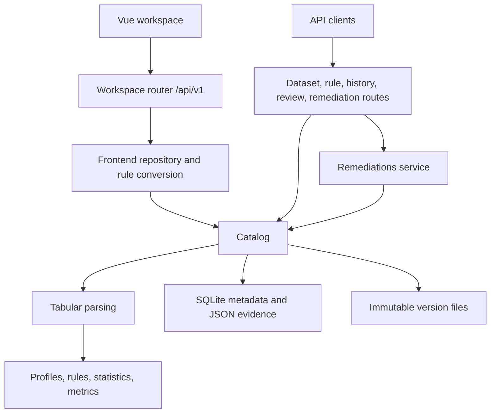

# DataGuard API Architecture

[README](../README.md) · [API reference](API.md) · [Data dictionary](DATA_DICTIONARY.md)

Trace your API requests from routing and validation through metadata storage and immutable dataset files.

## Table of Contents

- [Runtime structure](#runtime-structure)
- [Startup and shutdown](#startup-and-shutdown)
- [Request layers](#request-layers)
- [Upload and validation lifecycle](#upload-and-validation-lifecycle)
- [Persistence and concurrency](#persistence-and-concurrency)
- [Workspace projection](#workspace-projection)
- [Source map](#source-map)

## Runtime structure

Use this flow to trace requests through the API, analytical services, and storage:

## Startup and shutdown

Start with [create_app](../src/main.py) when configuring or testing the application. It loads Settings, validates YAML rules, builds a Catalog, installs CORS and exception handlers, and registers five route groups. Use the application lifespan to initialize the database and catalog and dispose the database engine on shutdown.

On startup, expect initialization to create storage, enable SQLite WAL mode, upgrade Alembic to head, register or reuse default rules, and reconcile source files. Correct invalid rule configuration before starting the service. Run the seed command explicitly when you want demo datasets.

## Request layers

| Layer | Responsibility |
| --- | --- |
| Routers | Multipart/query/body validation, status codes, response models |
| FrontendRepository | Complete workspace projections, editor conversion, friendly download names |
| Catalog | Transaction boundaries, source versions, assigned rules, check runs, findings, reviews, audit |
| Remediations | Proposal lifecycle, preview tokens, approval, exact replacement, comparison |
| Analytical services | Parse values, profile data, evaluate rules, calculate metrics and statistics |
| Database/FileStorage | SQLite sessions, migrations, atomic publication, content verification, reconciliation |

Use the workspace adapter for frontend JSON projections and validate those responses in the browser. Use lower-level routes for explicit Pydantic response models. Find public routes in the [API reference](API.md); service models such as `DatasetDetail` support projection logic without exposing their own route.

## Upload and validation lifecycle

Preserve this sequence when extending upload processing:

1. Validate file type and upload limits; parse records and collect metadata.
2. Resolve a saved rule revision or use the default.
3. In a database write transaction, create the dataset if necessary, publish an immutable source file, append a version and audit events, and create a check attempt.
4. Process the check with its pinned configuration, settings, reference date, and parent-version baseline.
5. Save result JSON, persistent findings, processing state, and audit events.

Allow the request to complete synchronous processing; the service has no external queue or distributed worker. If analysis fails, inspect returned resource IDs because the backend may already have committed a source version. Retry that version's check instead of reuploading.

Read `processing_status` for execution state (`running`, `completed`, `failed`) and `validation_status` for the result (`passed`, `failed`, `not_available`). Handle a completed check with invalid data as a successful HTTP operation that requires data review.

## Persistence and concurrency

Use [Database](../src/database.py) for metadata access at `storage/metadata.sqlite3`. It enables foreign keys, allows a 30-second busy timeout, and starts writes with `BEGIN IMMEDIATE` to serialize writers and support source/version conflict checks.

Publish and read version files through [FileStorage](../src/services/storage.py). It uses an exclusive temporary file, flush/fsync, and atomic hard-link publication under `storage/files/`, and verifies SHA-256 on reads. Restore the database and file directory from the same snapshot: startup reconciliation removes managed temporary and unreferenced files.

Identify datasets by their UUIDs, which the backend generates independently for ordinary uploads. Keep version, check, finding, and rule revision IDs distinct, and use filenames only for display. Follow parent links to trace source history and check attempts. When changing review state, preserve source bytes and snapshot the review state in each check.

Supply the current version for cell edits and revalidation. Coordinate ruleset edits because assignment lacks an expected-revision/ETag precondition. Check persisted state before retrying general writes, which lack idempotency keys. You can repeat execution of the same completed remediation to retrieve its original result version and check.

## Workspace projection

Account for complete datasets, histories, and review groups when consuming workspace responses; the adapter reparses source data as needed and converts snake_case models to camelCase. Display row-based scores from completed validation results. Query lower-level APIs when you need audit events or analytical evidence beyond the UI projection.

Use workspace revalidation to apply pending changes. It returns unchanged data without a new check, checks edited/unvalidated/failed versions in place, and can create identical-byte versions for rule-only or review-only changes. Use a lower-level version check to append a new attempt unconditionally.

## Source map

Locate the implementation for your change in these files:

| Path | Responsibility |
| --- | --- |
| [src/main.py](../src/main.py) | App factory, lifespan, middleware, health, exception handlers |
| [src/settings.py](../src/settings.py) | Environment settings and defaults |
| [src/frontend_routes.py](../src/frontend_routes.py) | `/api/v1` workspace contract |
| [src/routes.py](../src/routes.py) | Upload, stateless profile/check |
| [src/persistence_routes.py](../src/persistence_routes.py) | Dataset/version/run/finding/audit/review endpoints |
| [src/rule_routes.py](../src/rule_routes.py) | Rule revision creation and assignment |
| [src/remediation_routes.py](../src/remediation_routes.py) | Proposal lifecycle and comparison |
| [src/schemas.py](../src/schemas.py) | API and internal data transfer models |
| [src/rules.py](../src/rules.py) | Strict rule schema and duplicate-key-safe YAML loading |
| [src/models.py](../src/models.py) | SQLAlchemy metadata records |
| [src/services/catalog.py](../src/services/catalog.py) | Persistent workflows and transaction coordination |
| [src/services/frontend_repository.py](../src/services/frontend_repository.py) | Browser-facing projection and operations |
| [src/services/frontend_rules.py](../src/services/frontend_rules.py) | Editor catalog and bidirectional rule mapping |
| [src/services/tabular.py](../src/services/tabular.py) | Format parsing, limits, exact replacement serialization |
| [src/services/validation.py](../src/services/validation.py) | Rule evaluation, evidence, check snapshots |
| [src/services/profiling.py](../src/services/profiling.py) | Column profiles and numeric summaries |
| [src/services/statistics.py](../src/services/statistics.py) | IQR, schema change, missingness, count, and category drift |
| [src/services/metrics.py](../src/services/metrics.py) | Row-based quality metrics |
| [src/services/cell_review.py](../src/services/cell_review.py) | Grouping and ignore membership |
| [src/services/remediation.py](../src/services/remediation.py) | Approval-based corrections |
| [src/services/identifiers.py](../src/services/identifiers.py) | Identifier resolution and automatic rules |
| [src/services/value_parsing.py](../src/services/value_parsing.py) | Finite decimal and date parsing |
| [src/services/rule_syntax.py](../src/services/rule_syntax.py) | Portable regex and allowed-value syntax |
| [src/database.py](../src/database.py), [src/services/storage.py](../src/services/storage.py) | SQLite sessions and immutable files |
| [src/migrations/](../src/migrations/) | Alembic schema/data migrations |
| [src/scripts/](../src/scripts/) | Seeding, fixtures, evaluation |
| [config/](../config/) | Generic/facilities rules and demo manifest |
| [src/tests/](../src/tests/) | Unit, integration, migration, and API tests |
