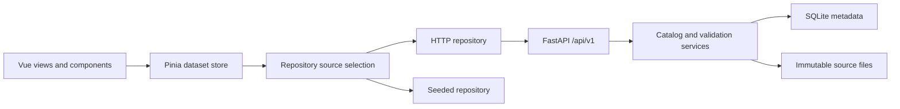

# Dataguard Frontend Architecture

[README](../README.md) · [Data dictionary](DATA_DICTIONARY.md) · [Backend architecture](../../datagaurd.back-end/docs/ARCHITECTURE.md)

Trace your workspace actions through Vue views, Pinia stores, and the live or sample data repositories.

## Table of Contents

- [Application flow](#application-flow)
- [Routes and navigation](#routes-and-navigation)
- [Source selection and failures](#source-selection-and-failures)
- [REST boundary](#rest-boundary)
- [Validation lifecycle](#validation-lifecycle)
- [Source map](#source-map)
- [Extend the application](#extend-the-application)

## Application flow

Follow this flow to trace a user action from the Vue interface to its data source:

1. [main.ts](../src/main.ts) installs Pinia, Vue Router, and global styles, then mounts the application.
2. The selected view loads the dataset store. Concurrent loads share one pending promise; an already-ready store does not reload the entire workspace.
3. The repository selects one complete workspace source. The store receives datasets, the rule-editor catalog, and source information.
4. Components display backend projections or equivalent calculated sample projections. Live results are authoritative; the browser does not recalculate them.
5. Successful writes replace the affected dataset in the store with the response. Rules and review dialogs keep errors visible when a save fails.

## Routes and navigation

Use [router/router.ts](../src/router/router.ts) to configure these routes relative to the `/dataguard/` base in [vite.config.ts](../vite.config.ts). Open `/dataguard/datasets` for the `/datasets` route and `/dataguard/?dataset=<uuid>` for a dataset link:

| Route | Behavior |
| --- | --- |
| `/` | Overview; uses selected dataset, last recent dataset, or first available dataset |
| `/overview` | Alias for overview |
| `/?dataset=<uuid>` | Opens a specific dataset; an unknown ID shows an unavailable state |
| `/datasets` | Searchable catalog and upload entry point |

Keep `/api/v1` at the API origin root; the frontend base path does not prefix API requests. Identify datasets by UUID because names and filenames can repeat. Dataset query parameters use the stored ID directly; sample names are not aliases. The router sets the page title to `Dataguard | Overview` or `Dataguard | Datasets`.

Use the recent-dataset store to preserve navigation history. It stores at most three `{ datasetId, openedAt }` entries under `dataguard.recentDatasets.v1` and removes entries absent from the selected workspace. Stored IDs are used as-is. Malformed or unavailable local storage does not prevent navigation.

## Source selection and failures

Consult [datasetRepository.ts](../src/services/datasetRepository.ts) and [httpDatasetRepository.ts](../src/services/httpDatasetRepository.ts) when changing source selection or transport behavior. Preserve these outcomes:

| Event | Behavior |
| --- | --- |
| `VITE_DATA_SOURCE=seeded` | Select sample repository without requesting the API |
| Successful initial workspace response | Select API, even when `datasets` is empty |
| Network failure or timeout during initial load | Select the complete sample workspace |
| HTTP 502, 503, or 504 during initial load | Select samples, including structured responses with those statuses |
| HTTP 500 without JSON content type | Treat as unavailable, covering the development proxy's upstream failure |
| HTTP 404 from the workspace endpoint during initial load | Log the 404 in the browser console and select samples because the API endpoint is unavailable, regardless of response format |
| JSON HTTP 500, 401/403, dataset HTTP 404, 422, or malformed success contract | Show the failure instead of falling back |
| Failure after selecting live data | Keep the live source and show the error; never replay writes against samples |
| Reconnect from fallback banner | Reload page, discard sample edits, and try initial selection again |

Allow 15 seconds for workspace loading and 120 seconds for other requests, including response-body reads. The client removes a trailing base-URL slash, URL-encodes IDs, parses structured error messages, and derives download names from Content-Disposition.

Check saved state before retrying an aborted write: the server may already have committed it. After a revalidation failure, the store refreshes the dataset; if that refresh also fails, it marks results unconfirmed and pending. Account for the lack of general idempotency keys when retrying uploads or ruleset writes.

## REST boundary

Use the workspace adapter for frontend data access. Resolve these paths against `VITE_API_BASE_URL`, normally `/api/v1`:

| Method | Path | Payload/result |
| --- | --- | --- |
| GET | `/workspace` | `{ datasets, ruleCatalog }` |
| GET | `/upload-policy` | Allowed extensions and resource limits |
| POST | `/datasets` | Multipart `file`, optional `sheet_name`; dataset projection, HTTP 201 |
| GET | `/datasets/{id}` | Current dataset projection |
| PUT | `/datasets/{id}/ruleset` | Editor `DatasetRuleset`; updated dataset |
| POST | `/datasets/{id}/validation` | `{ "version": "v1" }`; updated dataset |
| POST | `/datasets/{id}/cell-reviews` | Version, group, row, scope, and action; updated dataset |
| GET | `/datasets/{id}/file?version=v1` | Immutable version bytes |

Validate workspace, dataset, and upload-policy responses through [workspaceResponse.ts](../src/services/workspaceResponse.ts) before storing them. The frontend consumes these projections directly. Use [backend.ts](../src/types/backend.ts) for shared rule, finding, and upload types and the frontend domain types for UI projections. When you change a contract, update both projects and their fixtures. Consult the backend [API reference](../../datagaurd.back-end/docs/API.md) for additional routes.

## Validation lifecycle

After saving rules, replacing cells, deleting rows, or ignoring findings, select **Run Dataset Validation** to refresh scores, profiles, and findings. Ruleset saves update the assignment and mark results stale. Cell edits create an unvalidated source version; ignores change review state without changing source bytes. The workspace adapter returns an unchanged current dataset without creating a redundant check.

Use `processingStatus` to display progress. The store clears results during a run, and the overview polls every three seconds while the status is `running`. The backend normally validates synchronously. Rule-only or ignore-only revalidation can create a version with identical source bytes; the backend checks edited, unvalidated, or failed versions in place. Use low-level `POST /versions/{id}/check` when you need a new attempt regardless of pending state.

## Source map

Use this map to locate the implementation you need to change:

| Path | Responsibility |
| --- | --- |
| [src/views/](../src/views/) | Overview and dataset catalog orchestration |
| [src/components/layout/](../src/components/layout/) | Sidebar, breadcrumb, and workspace source notice |
| [src/components/shared/](../src/components/shared/) | Modal focus behavior, page headings, loading states, and shared icons |
| [src/components/datasets/](../src/components/datasets/) | Searchable catalog, dataset rows, and upload dialog |
| [src/components/overview/](../src/components/overview/) | Profiles, quality cards, history, recents, and validation status |
| [src/components/rules/](../src/components/rules/) | Rules dialog, individual rule rows, and typed condition inputs |
| [src/components/cell-review/](../src/components/cell-review/) | Finding groups, pagination, correction forms, and ignore forms |
| [src/stores/datasets.ts](../src/stores/datasets.ts) | Workspace hydration, mutation responses, uploads, run reconciliation |
| [src/stores/recentDatasets.ts](../src/stores/recentDatasets.ts) | Recent navigation persistence |
| [src/composables/](../src/composables/) | Dataset selection, downloads, uploads, rules editing, review actions, and validation polling |
| [src/services/datasetRepositoryContract.ts](../src/services/datasetRepositoryContract.ts) | Shared repository interface and error types |
| [src/services/seededDatasetRepository.ts](../src/services/seededDatasetRepository.ts) | In-memory version storage and repository orchestration |
| [src/services/seededCellReview.ts](../src/services/seededCellReview.ts) | Immutable sample corrections, ignores, and review queue updates |
| [src/services/seededValidation.ts](../src/services/seededValidation.ts) | Combine sample rule findings, statistics, and ignored findings |
| [src/services/seededSession.ts](../src/services/seededSession.ts) | Shared sample session types, signatures, version names, and history entries |
| [src/services/datasetValidation.ts](../src/services/datasetValidation.ts) | Row-based metrics and validation findings |
| [src/services/rulesetValidation.ts](../src/services/rulesetValidation.ts) | Ruleset validation and prepared rule checks |
| [src/services/datasetProfiling.ts](../src/services/datasetProfiling.ts), [datasetValues.ts](../src/services/datasetValues.ts) | Column profiles and shared missing, numeric, and date parsing |
| [src/services/seededStatistics.ts](../src/services/seededStatistics.ts) | Sample statistical analysis |
| [src/services/ruleExport.ts](../src/services/ruleExport.ts) | Convert sample rules for the backend seed manifest |
| [src/services/ruleSyntax.ts](../src/services/ruleSyntax.ts) | Portable patterns and allowed-value parsing |
| [src/services/cellReview.ts](../src/services/cellReview.ts) | Review grouping and cell membership |
| [src/data/](../src/data/) | Deterministic sample rows, IDs, rules, and data factories |
| [src/types/](../src/types/) | Dataset, workspace, ruleset, review, and backend types |
| [src/assets/main.css](../src/assets/main.css) | Shared styles and Tailwind CSS `@theme` design tokens |
| [scripts/export-demo-manifest.mjs](../scripts/export-demo-manifest.mjs) | Export backend seed contract |

## Extend the application

To add a rule type, update the editor catalog/types, frontend validation and syntax, backend rule models/conversion/validation, and contract/parity fixtures together. To add a new data source, implement the repository contract and retain single-source selection and response validation.

Each workspace response includes all datasets, histories, and review groups. Browser-table pagination does not reduce that payload, and sample calculations run in the browser.

Keep views focused on composing components. Place nested UI units beside their feature parent. Every directory under `src` exposes an `index.ts` barrel; import across directories through these entry points (for example, `@/components/shared`, `@/composables`, or `@/services`). Use direct relative imports for modules within the same directory to avoid importing their own barrel and creating circular dependencies. Keep the global stylesheet import in `main.ts` explicit. Use props and emitted updates at component boundaries; rule rows replace their draft values rather than mutating the source dataset. Keep reusable stateful workflows in composables and pure data transformations in services.
