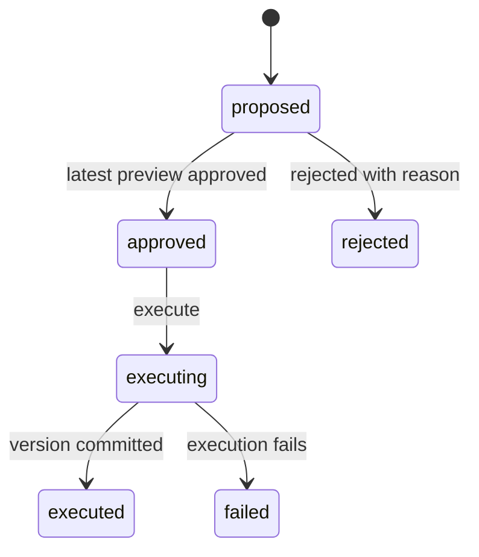

# Review Findings and Correct Data

[README](../README.md) · [API reference](API.md) · [Data dictionary](DATA_DICTIONARY.md)

Record your review decisions, correct flagged cells, or approve exact replacements while preserving dataset history.

## Table of Contents

- [Choose a workflow](#choose-a-workflow)
- [Record a finding decision](#record-a-finding-decision)
- [Apply a workspace cell action](#apply-a-workspace-cell-action)
- [Propose an approved remediation](#propose-an-approved-remediation)
- [Lifecycle and retries](#lifecycle-and-retries)
- [Compare results](#compare-results)

## Choose a workflow

Choose the workflow that matches the change you want to make:

| Workflow | Source changes | Validation/metric behavior |
| --- | --- | --- |
| Finding review | None | Append a decision; original findings and metrics remain unchanged |
| Workspace cell ignore | None | Suppress matching memberships on the next check; actual completeness remains unchanged |
| Workspace cell replacement/deletion | New CSV version | Mark pending; run validation separately |
| Approved remediation | New version in source format when exact preservation is possible | Execute and check; retain original source and proposal history |

## Record a finding decision

Start with a persistent finding ID from a completed run.

1. Fetch `/findings/{finding_id}` and page through `/findings/{finding_id}/records` to inspect evidence.
2. POST a decision to `/findings/{finding_id}/reviews`.
3. Read the decision history through GET on the same reviews path.

```json
{ "decision": "accepted_as_is", "reason": "Verified against the original source record." }
```

Choose `needs_correction`, `accepted_as_is`, or `dismissed`. Include a nonblank reason of at most 2,000 characters when accepting or dismissing a finding. Each decision appends your configured actor and a timestamp while preserving findings, scores, files, and prior decisions.

## Apply a workspace cell action

Fetch a group from `/api/v1/datasets/{dataset_id}` and use its current version and membership.

POST to `/api/v1/datasets/{dataset_id}/cell-reviews`:

```json
{
  "version": "v1",
  "groupId": "<returned-group-id>",
  "rowNumber": 2,
  "scope": "one",
  "action": { "type": "replace", "value": "FAC-9999" }
}
```

Use `value: null` to create missing data, `{ "type": "delete-row" }` to remove the whole record, or `{ "type": "ignore", "reason": "Verified" }` to suppress the selected finding. A replacement must differ from the current value and cannot be blank text or contain NUL. Literal `"null"` is text.

Set `scope: "all"` to select every member of the exact version/column/rule/value group, including rows outside your UI filters. Replace values individually in a unique column; the backend rejects shared replacements. Refresh your selection after a stale-version/group or changed-value conflict, and wait for active validation to finish before editing.

After a replacement or deletion, download the new BOM-prefixed UTF-8 CSV snapshot with quoted fields and CRLF line endings. You can still retrieve the original source version. Use current displayed row positions after deletion; stable row IDs preserve your ignore associations. To change review state without changing bytes, ignore a cell with an optional reason. Inspect older checks to retrieve their earlier review-state snapshots.

Run `/api/v1/datasets/{dataset_id}/validation` with the returned version label when ready. The backend checks edited versions in place and can append identical-byte versions for rule-only or ignore-only changes. Expect an unchanged response when the dataset needs no new check.

## Propose an approved remediation

Collect the latest persistent version ID, its content SHA-256, verified exact old values, and a nonblank reason before proposing a remediation.

1. POST `/remediations` with a column, distinct one-based record selections, their `expected_value`, and one replacement string.
2. GET `/remediations/{id}/records` to inspect the complete proposed change list.
3. POST `/remediations/{id}/preview`. Inspect selected/changed counts and samples; retain `preview_token`.
4. POST `/remediations/{id}/approve` with that token, or POST `/remediations/{id}/reject` with a reason.
5. POST `/remediations/{id}/execute` to create and validate the corrected version.
6. GET `/remediations/{id}/comparison` and the dataset audit history.

```json
{
  "source_version_id": "<latest-version-id>",
  "source_sha256": "<source-content-sha256>",
  "column": "inspection_score",
  "records": [{ "record_number": 8, "expected_value": "101" }],
  "replacement": "100",
  "reason": "Verified replacement from the source record."
}
```

Use `replace_value` for approved remediations and the workspace workflow for row deletion or cell ignores. Match the source hash and exact old values, and change at least one selected value. Submit another proposal if you need different input. Approve with the latest preview token, then execute the correction separately; approval records actor and time without changing source data.

## Lifecycle and retries



Track `proposed`, `approved`, `rejected`, `executing`, `executed`, and `failed` states through this lifecycle. At execution, the service rechecks the latest source and verifies that only your selected cells change. Choose a replacement the original format can represent exactly; otherwise, the service rejects execution.

If you lose an execution response, retrieve the proposal before retrying. Repeating an executed proposal returns the same corrected version/check and can resume its running check. If analysis failed, retry through `POST /versions/{result_version_id}/check` when appropriate. Retain the committed correction; a failed check does not undo it.

## Compare results

Read the comparison response for source/result versions, before/after checks, paginated changes, comparability, and metric differences in percentage points. Compare the before check captured at execution with the latest check for the corrected version, including retries. Interpret a missing delta as unavailable: the service calculates differences only for completed checks with matching analytical configurations.

Treat review and approval actors as configured service labels.
